<div align="center">

[English](README.md) · **한국어** · [日本語](README.ja.md) · [中文](README.zh-CN.md)

<br>

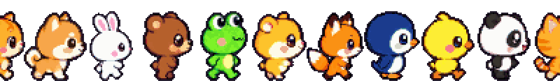

# claude-buddy: Claude Code 데스크톱 펫

Claude Code용 macOS 데스크톱 펫이에요. 세션과 서브에이전트가 하나씩 픽셀 동물이 되어 지금 하는 일을 작은 화이트보드에 적고, 일이 끝나거나 결정이 필요하면 사용자를 데리러 와요.

[](https://github.com/junyeongCHOI/claude-buddy)

<br>

Claude Code에 이 한 줄만 붙여 넣으면 이사 갈게.

```text
https://github.com/junyeongCHOI/claude-buddy 설치하고 실행해 줘. 다 되면 스타 누를지 물어봐 줘.
```

📌 기본으로는 Claude 데스크톱 앱에서 **고정한 세션만** 나와요.<br>전부 보고 싶으면 관계도 패널 헤더의 **고정 세션** 버튼을 꺼 주세요.

</div>

<br>

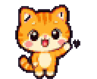 안녕. 나는 Claude Code 세션이 터미널 밖으로 나오면 이렇게 생겼어. 일하는 동안엔 작은 화이트보드 앞에 서서 지금 뭘 하는지 적어 두고, 다 끝나면 너한테 달려갈게. 이제 30초마다 터미널 힐끔거리지 않아도 돼.

<br clear="left">

## 하루 종일 하는 일

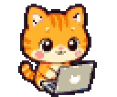 세션 하나에 동물 한 마리야. Claude 앱을 다시 켜도 같은 세션이면 같은 동물, 같은 털색으로 나와. 세션을 세 개 열어 두면 우리도 셋이 나와. 내 하루는 대충 이래.

<br clear="left">

- **보드에 적어.** 파일 읽기, 명령 실행, 코드 수정. Claude가 하는 일은 전부 보드에 써. 할 일이 바뀌면 지우개로 싹 지우고 마커로 한 글자씩 다시 쓰고, 바로 전에 한 일 두 개는 밑에 남겨 둬.
- **꼬맹이가 생겨.** 세션이 서브에이전트를 부르면 내 옆에서 조그만 동물이 튀어나와. 같은 세션이면 팀 색도 같아.
- **창 위를 걸어 다녀.** 창이랑 위젯 윗변을 걷고 점프해. 내가 올라가 있는 창을 끌면 같이 타고 가고, 창을 닫으면 떨어져.
- **모니터를 넘나들어.** 모니터가 여러 개면 전부 내 집이야. 일하는데 내 보드가 다른 모니터에 있으면 폴짝 건너가. 쉴 때는 지금 있는 화면 안에서만 놀아.
- **낮잠 자.** 10분 동안 아무 일도 없으면 서 있던 자리에서 그대로 잠들어.
- **꼬맹이는 보고하러 와.** 일 끝난 서브에이전트는 부모한테 걸어가서 두루마리를 건네고 사라져.

## 네가 필요할 때

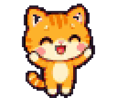 세션이 일을 다 끝냈거나, 질문에 답하거나 계획을 승인해 줘야 할 때는 마우스 커서 옆으로(다른 모니터에 있어도) 뛰어가서 손을 흔들어. 머리 위 말풍선에 `다 했어요!`인지 `결정이 필요해요!`인지, 그리고 세션 이름(질문이면 질문 내용)을 띄워.

<br clear="left">

- 몇 초마다 폴짝 뛰고 발밑이 두근두근 빛나. 1분 지나면 좀 얌전해지고, 5분 지나면 더 뜸해져. 부르는 동안엔 안 잘게.
- 나한테 마우스를 잠깐 올리거나, 클릭하거나, 집어 들거나, 내 보드를 누르면 봤다는 뜻으로 알아들어. 하트 띄우고 멈출게. 같은 기다림 동안엔 다시 안 불러.
- 네가 Claude Code에서 그 세션을 직접 보고 있어도 본 걸로 쳐. Claude 앱이 맨 앞에 있고 그 세션이 열려 있거나(나눠 보기 칸도 포함), CLI 세션이면 그 세션이 도는 터미널·IDE 창이 맨 앞에 있을 때야(그 앱 안에 Claude 세션이 하나뿐일 때만). 다만 부르기 직전 20초 안이나 그 뒤에 마우스를 움직였을 때만 쳐. 자리 비운 사이에 창이 우연히 앞에 있던 걸 수도 있으니까.
- 세션이 알아서 다시 일을 시작해도 멈춰. 네가 Esc로 직접 멈춘 턴은 아예 안 불러. 이미 알 테니까.

대답은 여전히 Claude Code에서 해야 해. 나는 데리러 가는 것까지만.

## 표정 읽는 법

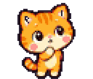 날 보면 세션이 지금 뭐 하는지 알 수 있어. 사진은 친구들이 좀 도와줬어.

<br clear="left">

| | 상태 | 언제 | 뭘 하냐면 |
| :-: | --- | --- | --- |
|  | 작업 중 | 도구 호출이 진행 중일 때 | 보드 앞에서 읽고, 타자 치고, 생각해. 오래 걸리면 관련 창을 구경하러 가 |
|  | 꼬맹이 기다리는 중 | 진행 중인 호출이 서브에이전트일 때 | 생각 구름 띄우고 고민해 |
| 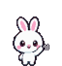 | 확인 필요 | 세션이 네 확인을 기다리거나, 질문·승인 도구가 열려 있을 때 | 손 흔들고 폴짝폴짝 |
| 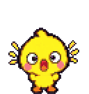 | 요청 받음 | 새 요청이 온 지 6초 안 됐을 때 | 머리 위로 편지가 떨어져서 깜짝 놀라 |
|  | 말하는 중 | 답한 지 15초 안 됐을 때 | 방긋 |
| 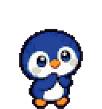 | 생각 중 | 일하는 중인데 위 경우가 다 아닐 때 | 생각 구름 |
| 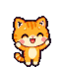 | 다 했어 | 막 일을 끝냈을 때 (20초쯤) | 반짝반짝 환호 |
| 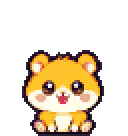 | 쉬는 중 | 일은 없는데 아직 잘 시간은 아닐 때 | 걷고, 뛰고, 앉고. 내 맘대로 |
|  | 자는 중 | 아무 일 없이 10분이 넘었을 때 | 웅크리고 Zzz. 보드는 치워 |
| 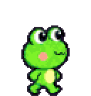 | 보고하러 감 | 서브에이전트가 일을 끝냈을 때 | 두루마리 들고 부모한테 갔다가 사라져 |

이럴 때도 반응해.

| 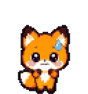 | 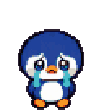 | 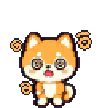 | 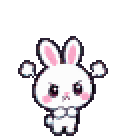 | 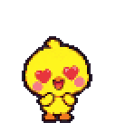 |
| :-: | :-: | :-: | :-: | :-: |
| 도구에서 오류 💦 | 네가 중단했을 때 | 너무 세게 던졌을 때 | 자는데 깨웠을 때 💢 | 부르는 거 알아봐 줬을 때 |

## 시작하기

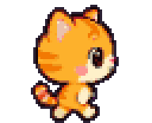 날 데려가는 제일 쉬운 방법은 Claude Code한테 맡기는 거야. Claude Code 세션을 열고 이걸 그대로 붙여 넣어.

<br clear="left">

```text
https://github.com/junyeongCHOI/claude-buddy 설치하고 실행해 줘. 다 되면 스타 누를지 물어봐 줘.
```

스타 눌러 줄지 물어보면 좋다고 해 줘. 스타는 내 간식이거든. ⭐

macOS, Node.js 22 이상, npm이 필요해. 빠진 게 있으면 Claude가 알려 줄 거야.

> [!IMPORTANT]
> **나는 고정(핀)한 세션에만 나와.** Claude 데스크톱 앱 사이드바에서 세션을 고정하면 튀어나오고, 고정을 풀면 손 흔들고 사라져.
>
> **돌아가는 세션 전부 보고 싶으면?** 관계도 패널 헤더의 **고정 세션** 버튼(켜져 있으면 파란색)을 끄거나, 메뉴 막대 **🐾** 에서 **고정한 세션만 보기** 를 꺼 줘. 둘은 같은 설정이야. 켜져 있는데 고정한 세션이 없으면 패널이 알려 줘.
>
> 데스크톱 앱 없이 CLI만 쓰면 처음부터 다 나와.

<details>
<summary>직접 설치하기</summary>

<br>

```bash
git clone https://github.com/junyeongCHOI/claude-buddy.git
```

```bash
cd claude-buddy && npm install
```

```bash
npm start
```

</details>

실제 세션 없이 어떤지 구경만 하고 싶으면 데모 친구들을 불러.

```bash
npm run demo
```

- `npm start`는 먼저 작은 Swift 헬퍼를 빌드해. 그걸로 창 위치를 알아내거든. Xcode Command Line Tools에 들어 있는 `swiftc`가 필요한데, 없어도 실행은 돼. 대신 창 위로는 못 올라가고 바닥이랑 보드 선반에서만 놀아.
- API 키도 Python도 필요 없어.
- 맥에 부담 안 주려고 노력해. 평소엔 30fps, 아무도 안 움직이면 12fps로 쉬고, 창 위치 헬퍼도 창이 가만히 있으면 400ms에 한 번만 봐.

## 나 만지는 법

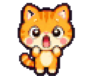 만져도 돼. 살살만.

<br clear="left">

- **끌면** 집혀. 놓으면 던져져. 나나 내 보드를 다른 모니터로 옮겨도 돼.
- **클릭하면** 표정으로 반응하고 카드가 열려. 상태, 폴더, 부모·도우미, 받은 요청, 도구별 사용 횟수, 최근 활동이 나와. 카드 밖 아무 데나 누르면(다른 앱이어도) 닫혀. 카드의 **열기 ↗** 를 누르면 그 세션으로 바로 가. 데스크톱 앱 세션이면 Claude 앱으로, 터미널 세션이면 그 세션이 돌고 있는 터미널 탭으로(Terminal, iTerm2).
- **화이트보드**: 헤더를 끌면 옮겨져. `−`는 이름이랑 상태만 남기고 접고, `+`는 다시 펼쳐. 왼쪽 아래 모서리를 끌면 크기가 바뀌고, 그 모서리를 더블클릭하면 글에 맞는 자동 크기로 돌아가.
- **관계도 패널**: 줄을 누르면 그 동물이 반짝 강조되고 카드가 열려. 헤더를 끌면 옮겨지고, 다른 모니터로도 넘어가. 커서가 있는 화면으로 건너가서 그 안에 쏙 맞춰 들어가고, 옮긴 자리는 다음에 켜도 기억해. 모으기랑 새 화이트보드 자리는 패널이 있는 모니터 기준이야. 헤더 버튼은 왼쪽부터 **고정 세션** (고정한 세션만 보일 때 파란색), **모으기** (흩어진 애들을 패널 있는 모니터 가운데로 뿅 모으고 메인 보드도 다시 자리 잡게 해), **⋯** (🐾 메뉴랑 똑같은 메뉴), `−`/`+` (접고 펴기)야.
- 우리 말고 다른 데를 누르면 클릭은 밑에 있는 앱으로 그냥 넘어가. 실제로 그려진 픽셀만 잡히니까 내 주변 투명한 여백도 안 막아.

나머지는 메뉴 막대의 **🐾** 아니면 패널의 **⋯** 버튼에 있어. 둘 다 같은 메뉴야.

| 메뉴 | 하는 일 |
| --- | --- |
| 친구들 모으기 | 패널의 **모으기** 버튼이랑 같아 |
| 패널 디스플레이 | 고른 모니터 오른쪽 위로 패널 옮기기. 새 동물이랑 보드는 패널 있는 모니터에 처음 놓여 |
| 관계도 패널 | 세션·서브에이전트 목록 보이기 |
| 고정한 세션만 보기 | 켜면(기본) 고정한 세션만, 끄면 살아 있는 세션 전부. 패널의 고정 세션 버튼이랑 같은 설정 |
| 쉬는 세션도 보기 | 자는 동물도 화면에 남겨 두기 |
| 캐릭터 크기 | 작게(0.75), 보통(1), 크게(1.5) |
| 언어 · Language | 시스템 설정 따르기, 한국어, English, 日本語, 简体中文. 바로 바뀌고, 보드에 이미 적힌 것도 새 언어로 보여 |
| 로그인할 때 자동 실행 | macOS 켤 때 같이 실행 |
| 화이트보드 위치 초기화 | 저장된 보드 위치·크기 잊고 자동 배치로 |
| 다시 불러오기 | 앱 화면 새로고침 |
| 종료 | 종료 |

나는 한국어, 영어, 일본어, 중국어(간체)를 할 줄 알아. 기본으로는 macOS 언어 순서를 따르고, 그 밖의 언어면 영어로 말해.

## 내가 읽는 것

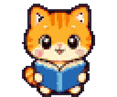 나는 네 맥에 있는 파일만 읽어. 어디로도 안 보내고, Claude Code 파일은 건드리지도 않아. 창 위치도 화면을 찍지 않는 macOS API로 알아내서 화면 기록 권한도 필요 없어.

<br clear="left">

<details>
<summary>정확히 어떤 파일인지</summary>

<br>

| 파일 | 거기서 알아내는 것 |
| --- | --- |
| `~/.claude/sessions/<pid>.json` | 살아 있는 Claude Code 프로세스의 세션 ID, 이름, 작업 폴더, 작업·대기 상태 |
| `~/.claude/projects/<인코딩된 cwd>/<sessionId>.jsonl` | 메인 에이전트의 요청, 응답, 도구 호출과 결과, 중단 |
| `~/.claude/projects/<인코딩된 cwd>/<sessionId>/subagents/agent-<id>.jsonl` | 서브에이전트 활동 |
| 같은 `subagents` 폴더의 `agent-<id>.meta.json` | 서브에이전트 종류, 설명, 부모 도구 호출 ID, 완료 여부 |
| `~/Library/Application Support/Claude/claude_desktop_config.json` | 데스크톱 앱에서 고정한 세션 |

- `<인코딩된 cwd>`는 작업 폴더 경로에서 영문·숫자 말고는 전부 `-`로 바꾼 이름이야. 거기 없으면 다른 프로젝트 폴더도 뒤져 봐.
- 처음엔 트랜스크립트 끝부분만 읽고, 그다음부터는 새로 붙은 줄만 읽어.
- 창 위치는 `native/winwatch.swift`를 빌드한 `native/bin/winwatch`가 알려 줘. `CGWindowListCopyWindowInfo`로 창이 어디 있고 어느 앱 건지만 받고, 화면 이미지는 안 찍어. 다른 창에 가려진 윗변은 발판으로 안 써.
- 디스플레이·표시·크기 설정은 Electron `userData` 폴더의 `config.json`에, 보드 배치랑 패널 위치는 렌더러 `localStorage`에 저장해.
- 딱 하나 예외는 아래 개발자용 스프라이트 생성 스크립트야. 그건 OpenAI API를 불러. Claude Code 데이터는 안 읽어.

</details>

## 뭔가 이상하면

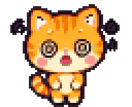 으, 또 이상한 데 떨어졌나. 이것부터 봐 줘.

<br clear="left">

| 증상 | 확인할 것 |
| --- | --- |
| 창 위로 안 가고 바닥이랑 보드에서만 놀아 | `swiftc --version`으로 컴파일러가 있는지 보고, `npm run build:native` 경고랑 `native/bin/winwatch`가 생겼는지 확인해 줘. 윗변이 화면 위쪽 96px 안에 있거나 다른 창에 가려진 창은 발판이 아니야. |
| 아무도 안 나와 | 실제 Claude Code 세션이 있는지, 고정은 했는지(아니면 패널 헤더의 **고정 세션** 버튼을 꺼 줘) 봐 줘. `npm run demo`로 화면 쪽만 따로 확인할 수 있어. 오래 자서 숨겨졌다면 **쉬는 세션도 보기** 를 켜 줘. |
| 다른 모니터로 옮기고 싶어 | 나나 내 보드, 패널을 그냥 끌어다 놔. 새로 나오는 동물은 패널 있는 모니터에 나와. 🐾 → **패널 디스플레이** 를 고르면 패널이 그 모니터 오른쪽 위로 가. |
| 누가 어디 갔는지 모르겠어 | 패널 헤더의 **모으기** 버튼이나 🐾 → **친구들 모으기**. 다들 패널 있는 모니터로 뿅 모여. |
| 보드가 너무 크거나 잘려 | 왼쪽 아래 모서리를 더블클릭해서 자동 크기로 돌리고 헤더를 끌어서 옮겨. |
| 브라우저 미리보기에 실제 세션이 안 나와 | 원래 그래. 미리보기는 데모 데이터랑 가짜 창을 써. 진짜는 `npm start`로 봐. |
| `Electron failed to install correctly` | Electron 실행 파일을 아직 못 받은 거야. `node node_modules/electron/install.js` 실행하고 다시 켜 줘. |

## 자주 묻는 질문

### 터미널을 안 보고도 Claude Code가 뭘 하는지 알 수 있나요?
claude-buddy를 실행하면 돼요. Claude Code 세션마다 바탕화면에 픽셀 동물이 하나씩 나오고, 화이트보드에 지금 하는 일이 적혀요. 어떤 파일을 읽는지, 어떤 명령을 실행하는지, 무엇을 기다리는지요. 세션이 일을 끝내거나 결정이 필요하면 동물이 마우스 커서 옆으로 달려와요.

### 서브에이전트도 보이나요?
네. 서브에이전트는 부모 옆에 더 작은 동물로 나오고, 팀 색도 같아요. 일을 마치면 부모에게 걸어가 두루마리를 건네요.

### 내 데이터를 밖으로 보내나요?
아니요. claude-buddy는 `~/.claude` 아래 Claude Code 로컬 파일을 읽기만 하고 고치지 않아요. 창 위치도 화면을 찍지 않는 macOS API로 알아내서 화면 기록 권한이 필요 없어요.

### Claude 데스크톱 앱이 꼭 있어야 하나요?
아니요. Claude Code CLI만 써도 돼요. 데스크톱 앱이 있으면 기본으로 고정한 세션만 나오고, 관계도 패널 헤더의 **고정 세션** 버튼을 끄면 전부 나와요.

### Windows나 Linux에서도 되나요?
아직은 macOS만 지원해요.

### 어떤 언어를 지원하나요?
한국어, 영어, 일본어, 중국어(간체)예요. 기본은 macOS 언어 순서를 따르고, 🐾나 ⋯ 메뉴의 언어 · Language에서 언제든 바꿀 수 있어요.

### API 키가 필요하거나 돈이 드나요?
아니요. 로컬 파일만 읽고 API를 부르지 않아요. MIT 라이선스의 무료 오픈소스예요.

### Anthropic 공식 제품인가요?
아니요. claude-buddy는 개인이 만든 오픈소스 프로젝트이고, Anthropic과 제휴하거나 보증받은 제품이 아니에요.

## 개발자용

<details>
<summary>명령어</summary>

<br>

| 명령 | 하는 일 |
| --- | --- |
| `npm start` | 실제 Claude Code 세션을 바탕화면에 표시 |
| `npm run demo` | 실제 세션 대신 데모 친구들과 활동 표시 |
| `npm run preview` | 데모 데이터와 가짜 창으로 브라우저 미리보기. 주소는 <http://localhost:5174/src/renderer/index.html>. 뒤에 `?lang=ko`, `en`, `ja`, `zh`를 붙이면 언어를 고를 수 있음. ⋯ 메뉴는 여기선 안 보임 |
| `npm test` | Node 내장 테스트 |
| `npm run smoke` | 데모 렌더러를 띄워 6초간 콘솔을 지켜본 뒤 `{ok, errors, warnings}`를 출력. 오류 없으면 0, 있으면 1로 종료. 앱이 켜져 있으면 실패하니 트레이에서 먼저 종료 |
| `npm run build:native` | 창 위치 헬퍼만 빌드. `npm start`와 `npm run demo`는 이미 최신이면 다시 컴파일하지 않음 |

</details>

<details>
<summary>스프라이트 만드는 법</summary>

<br>

완성된 아틀라스는 이미 `assets/sprites/`에 있어. 우리를 다시 그리고 싶을 때만 필요해.

1. **원본 시트 생성**: `scripts/gen-sprites.mjs`가 `OPENAI_API_KEY`로 OpenAI 이미지 API를 불러. 기본값은 `--model gpt-image-2.5-flare`, `--sheet move`, `--quality high`, 동물 전체.

   ```bash
   node scripts/gen-sprites.mjs --sheet move --animals cat,dog
   ```

   ```bash
   node scripts/gen-sprites.mjs --sheet emote --animals cat,dog
   ```

   `move`는 걷기·보드 들기·점프·매달리기·낙하·앉기, `emote`는 표정·생각·잠·환호·손 흔들기·타이핑·독서야. 둘 다 마젠타 배경의 4열×5행 시트고, `assets/raw/<animal>-move.png`, `assets/raw/<animal>-emote.png`로 저장돼. `emote`는 같은 동물의 `move`를 참고 이미지로 보내서 생김새를 맞춰. 동물별 `NOTES`는 모델이 자꾸 틀리는 걸 막는 지시야. 개구리는 눈이 딱 두 개, 토끼는 모든 장면에서 긴 귀가 보여야 해.

2. **픽셀 정리**: `scripts/pixelate.py` (Python 3 + Pillow).

   ```bash
   python3 scripts/pixelate.py cat dog
   ```

   마젠타 배경을 지우고, 그림 덩어리를 격자 칸별로 묶고, 시트 전체를 같은 배율로 줄이고, 동물별 48색으로 줄이고, 1px 외곽선을 두르고, 발을 96px 칸 바닥에 맞춰 놓아(걷기 프레임 키는 48px). 결과물은 8열 아틀라스 `assets/sprites/<animal>.png`, 애니메이션 프레임·보드 위치·털 팔레트를 담은 `assets/sprites/<animal>.json`, 동물 목록 `assets/sprites/index.json`이야.

3. **실행 중 털색**: `src/renderer/sprites.js`가 에이전트 ID로 `SPECIES_FURS`에서 털색 하나를 골라. 털 팔레트에 해당하는 픽셀만 원래 음영을 살려서 다시 칠해.

</details>

<details>
<summary>프로젝트 구조</summary>

<br>

```text
claude-buddy/
├── src/
│   ├── main/
│   │   ├── main.js          # 오버레이 창, 트레이, 프로세스 간 메시지
│   │   ├── collector.js     # 세션·서브에이전트 수집
│   │   ├── tailer.js        # JSONL 끝부분과 새 줄 읽기
│   │   ├── windows.js       # Swift 헬퍼 실행, 창 위치 수신
│   │   ├── config.js        # 설정
│   │   └── reveal.js        # 세션이 돌고 있는 앱·터미널 탭을 앞으로
│   ├── preload.cjs          # window.buddy 연결
│   ├── shared/
│   │   ├── activity.js      # 기록 → 활동
│   │   ├── agent-state.js   # 활동 → 에이전트 상태
│   │   └── i18n.js          # 화면 글 4개 언어
│   └── renderer/
│       ├── app.js           # 진입점, 메시지, 배치, 마우스
│       ├── character.js     # 행동과 물리
│       ├── board.js         # 화이트보드
│       ├── world.js         # 창·위젯·보드 발판
│       ├── views.js         # 모니터마다 하나씩 있는 투명 오버레이
│       ├── perch.js         # 동물별로 보드에 붙어 있는 자세
│       ├── mode.js          # 상태 판정과 보드 문구
│       ├── panel.js         # 관계도와 상세 카드
│       ├── sprites.js       # 아틀라스와 털색
│       ├── effects.js       # 편지, 반짝이
│       └── demo.js          # 데모 활동과 가짜 창
├── native/winwatch.swift    # 창 위치 헬퍼
├── scripts/                 # 네이티브 빌드, 미리보기 서버, 스프라이트 파이프라인
├── test/
└── assets/
    ├── raw/                 # move·emote 원본
    ├── raw-rejected/        # 탈락한 원본
    └── sprites/             # 동물별 PNG + JSON
```

</details>

<br>

<div align="center">

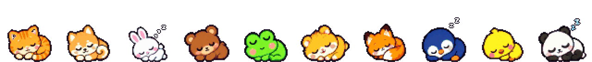

여기까지야. 난 네 브라우저 창 위에서 자고 있을게.<br>
(⭐ 하나면 아주 푹신한 베개가 돼.)

<sub>MIT License · Anthropic과 관계없는 개인 프로젝트예요. Claude와 Claude Code는 Anthropic, PBC의 상표입니다.</sub>

</div>
